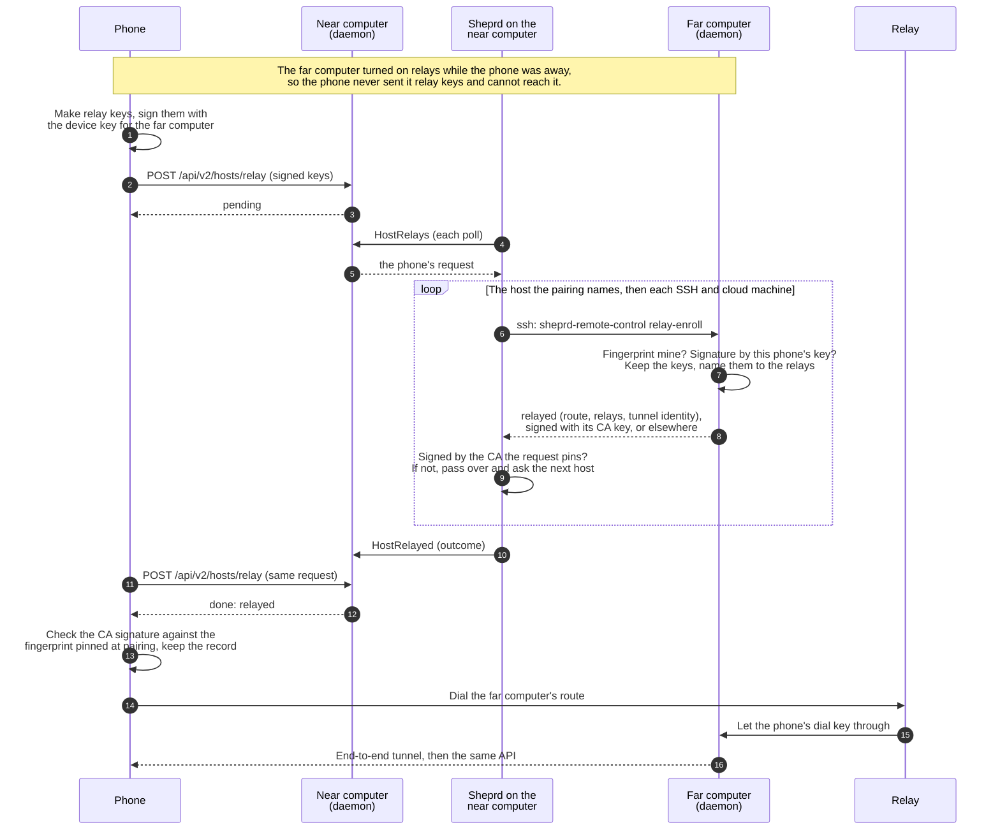

# Plan: Sheprd's own relay, replacing Tailscale

Today a phone reaches a computer's `sheprd-remote-control` daemon only on the
same network or over Tailscale, and Sheprd finds SSH machines through
`tailscale status`. Users without Tailscale lose both away from home. This
plan adds `sheprd-relay`: a small service we and anyone else can run, which
joins two Sheprd peers when they have no direct path, while seeing only
ciphertext. Read `AGENTS.md` first; its rules apply throughout.

Direct paths stay first. The relay is the fallback that makes a connection
work from any network, not a detour for traffic that has a better route.

## Decisions

| Question | Decision |
| --- | --- |
| What the relay is | A blind pipe: it joins two byte streams and counts bytes. It never holds a key that opens them. |
| Transport | QUIC on UDP 443 (quinn; `NWConnection` with QUIC on iOS): one connection per peer, a stream per session, no head-of-line blocking between sessions, and connection migration when a phone moves between Wi-Fi and cellular. A few fixed-size binary headers, then raw bytes; no protobuf or other codegen. WebSockets over HTTPS on TCP 443 stay as the fallback for networks that block UDP, so it always works. |
| Who can listen | Whoever proves a P-256 key. The route is SHA-256 of the key, so nobody can take over another computer's route. There are no accounts and nothing to authorize on the relay; an operator may set one optional token to keep a relay to their own computers. |
| Who can dial | Only devices the computer names. A computer gives the relay the public dial keys of its paired devices; any other dial hears `offline`, as if the computer were not there, and never reaches it. Revoking a device ends its sessions at once. |
| End-to-end encryption | Hybrid post-quantum Noise inside the stream (below). TLS to the relay protects only metadata. |
| State | None. Memory only; a restart drops sessions and listeners reconnect. No database, no volume. |
| Many relays | Relays share nothing and never forward to each other. A computer listens on every relay it knows; a dialer only ever dials the computer's relays, never its own, so two machines near different relays still meet. The dialer tries the relay with the shortest whole path first (Choosing the nearest relay). Adding a region is starting a droplet. |
| Choosing a relay | Sheprd's relays by default, listed in one static file, `https://sheprd.org/relays.json`, so they are added or all removed without a release; or the user's own: any number of private endpoints, which can replace ours entirely (below). |
| Zero config | Every setting has a safe default. The image runs with no settings; `deploy/relay` serves it at `IP.sslip.io` with a Let's Encrypt certificate and no DNS work. |
| Operator safety | Limits on connections (total and per address), listeners, sessions (total and per route), frame size, bandwidth (per session and total), idle and total session time, and dial and listen rates. |
| Telemetry | Prometheus at `/metrics` on its own port, and a read-only dashboard behind a login. Neither carries an address, a full route, or a byte of payload. |

### Still open

These change client work only; the relay is the same either way.

1. **Scope.** This plan covers both phone to daemon and Sheprd to SSH
   machines, phased. Phone to daemon comes first.
2. **One tunnel implementation or two.** Recommended: one Rust crate,
   `sheprd-tunnel`, used by the daemon and Sheprd, and by the iOS app through
   a small UniFFI framework, so the handshake is written and tested once.
   The other option is a Swift copy checked against shared test vectors.

## Architecture

```text
phone ──QUIC──▶ relay ◀──QUIC── computer (sheprd-remote-control, listening)
   └────── Noise IK + ML-KEM-768, end to end ──────┘

Sheprd ──QUIC──▶ relay ◀──QUIC── SSH machine (sheprd-relay-agent → 127.0.0.1:22)
   └──── Noise, then SSH's own encryption inside it ───┘

Either side may use a WebSocket over HTTPS instead, when UDP is blocked.
```

### The relay (`crates/sheprd-relay`, built)

Tokio, quinn, and axum. No GPUI, and no dependency on the client crates: it
knows streams, routes, and limits, nothing else.

#### QUIC (`wire`, `quic`)

ALPN `sheprd-relay/1`, TLS 1.3. Every stream a peer opens starts with one
request; the relay answers with one status byte. Keys are SEC1 compressed
P-256 (33 bytes), signatures `r ‖ s` (64).

| Request | Bytes |
| --- | --- |
| Listen | `0x01`, key, signature, token length (1), token (0–255) |
| Dial | `0x02`, route (32), dial key, signature |

A listener then says who may dial it, on its listen stream:

| Message | Bytes |
| --- | --- |
| Dial keys | `0x20`, count (1, at most 64), keys |
| Pairing key | `0x21`, key, lifetime in seconds (2, big-endian, at most 600) |

Statuses: `0` ok, `1` offline, `2` busy, `3` timeout, `4` limited,
`5` refused (bad proof), `6` forbidden (token), `7` full, `8` malformed,
`9` too many (pairing keys).

- **Proofs.** Listeners sign `"sheprd-relay/listen/quic/v1\0"`, dialers
  `"sheprd-relay/dial/quic/v1\0" ‖ … ‖ route`, each over 32 bytes exported
  from their own connection's TLS session (RFC 5705, label
  `EXPORTER-sheprd-relay-listen`). The export differs on every connection,
  so a proof cannot be replayed or passed through another relay, at no
  extra round trip.
- **Listening.** The listen stream stays open; closing it stops listening,
  and a newer listener for the same key resets it with code 5. Until it
  sends dial keys, no one can reach it.
- **Dialing.** Only a key the listener names, or an unexpired pairing key
  (used up by its one dial), gets through. Any other key gets `offline`,
  exactly as if no one listened. After `ok`, the stream is the session:
  raw bytes both ways. A phone holds one connection and opens a stream per
  computer it reaches.
- **Accepting.** For each dial, the relay opens a stream on the listener's
  own connection, starting with `0x10` and the dialer's key, so the
  computer knows which device calls before the end-to-end handshake. No
  new connection, no new handshake.
- **Revoking.** New dial keys replace the old set, and the relay resets
  every open session of a key left out (code 7) at once. Sessions opened
  with a pairing key are left alone, since approving a device replaces the
  keys while its pairing session is still open; they last 10 minutes at
  most.
- **Trust.** The relay makes a fresh key and self-signed certificate at
  each start, so it needs no volume and shares no file with the HTTPS
  proxy. `/v1/info`, read over ordinary HTTPS, gives the UDP port and the
  certificate's SHA-256, which clients pin; a client whose handshake fails
  reads it again. The end-to-end handshake inside the stream is what
  protects content; the pin protects the listen token and metadata.
- **Limits.** Connections count against the per-address limit before the
  handshake, so a flood costs no cryptography. 64 streams per connection;
  8 MiB stream and 32 MiB connection windows, so one session can fill a
  long, fast path; a 60-second idle timeout that clients' 15-second QUIC
  keepalives stay under.

#### WebSocket fallback and HTTP

| Route | What it does |
| --- | --- |
| `GET /v1/listen` | A computer's control socket. The relay sends `{"t":"challenge","nonce","version":1}`; the computer answers `{"key","signature","token"?}` over `"sheprd-relay/listen/v1\0" ‖ name ‖ 0x00 ‖ nonce`, where the name is the relay's host and path prefix as its endpoint gives them (`Endpoint::proof_name`, `relay.example.org/sheprd`). Binding the name stops one relay passing another's challenge through, prefixes included. The relay answers `{"t":"ready","route"}`. The computer sends `{"t":"dial_keys","keys"}` and `{"t":"pairing_key","key","seconds"}`, each answered `{"t":"status","status"}`, and hears `{"t":"incoming","session","key"}` for each dial. A newer listener with the same key replaces the older one, which is closed with 4409. |
| `GET /v1/dial/{route}` | The same challenge; the device answers `{"key","signature"}` over `"sheprd-relay/dial/v1\0" ‖ name ‖ 0x00 ‖ nonce ‖ route`, then hears `{"t":"status","status"}` with the same statuses as QUIC. After `ok`, binary frames are the session. |
| `GET /v1/accept/{session}` | The listener's socket for one dial. The session id is 128 random bits that only the listener learns, and it can be claimed once. |
| `GET /v1/info` | `{"protocol":1,"version","listen_token":bool,"quic":{"port","pin"},"websocket":bool}`, where `version` is the major and minor only (`0.1`), not an exact build, so a client can check an endpoint, know to ask for a token, and reach QUIC, before saving it. |
| `GET /healthz` | For uptime checks. |
| `/dashboard` | The read-only dashboard, when an access token is set. |

`/v1/listen`, `/v1/dial`, and `/v1/accept` refuse with 403, before anything
is counted or held, a request a browser sends for a page on another site:
`Sec-Fetch-Site` other than `same-origin` or `none`, or an `Origin` that is
not the relay's own host. Otherwise any web page could open them from its
visitors' browsers, earn their addresses bans, and hold listener slots.
Clients send neither header, or their own relay origin.

WebSocket proofs cover the relay's own name, `RELAY_PUBLIC_HOST` (set from
the domain by `deploy/relay`), which the relay checks against its
configuration, never against the request's `Host`: a client sets that
header, so a malicious relay could pass another relay's challenge to a
computer and then present the proof with its own name in `Host`. Without a
public name the fallback is off and `/v1/info` says `"websocket": false`;
QUIC, whose proofs bind the TLS session itself, needs no name.

Data is binary frames only. A text frame ends the session (4400), and a
frame over `max-frame` breaks it. A revoked key's session closes with
4403. Close codes are in `splice::code`; the messages are in `socket`.

A session may mix transports: a phone on QUIC reaches a computer that could
only open a WebSocket, and the other way round.

The relay pings idle listeners every 25 seconds, which keeps NAT mappings
open. Inside a session, keepalives are the peers' job: they are encrypted,
so the relay cannot tell a keepalive from data.

### Limits

All settings are flags or `RELAY_*` variables (`sheprd-relay --help`).

| Setting | Default | Bounds |
| --- | --- | --- |
| `max-connections` | 10,000 | Open sockets of every kind |
| `max-connections-per-ip` | 64 | Per IPv4 address or IPv6 /64 |
| `max-listeners` | 5,000 | Routes with a listener |
| `max-listeners-per-ip` | 16 | Per IPv4 address or IPv6 /64; a /24 or /48 holds 16 times this |
| `max-sessions` | 5,000 | Sessions and waiting dials |
| `max-sessions-per-ip` | 64 | Per dialing address; a /24 or /48 holds 16 times this |
| `max-sessions-per-key` | 4 | Per dial key, so a stolen key cannot take every slot of its computer |
| `max-sessions-per-route` | 32 | Per computer |
| `max-buffer` | 512 MiB | What QUIC peers may make the relay hold, across connections |
| `session-bandwidth` | 4 MiB/s | Each way, per session; 0 is unlimited |
| `total-bandwidth` | 64 MiB/s | Each way, across sessions; 0 is unlimited |
| `max-frame` | 64 KiB | Largest frame |
| `idle-timeout` | 5 min | Silent session |
| `max-session-duration` | 24 h | Any session |
| `accept-timeout` | 10 s | Listener's time to accept |
| `dials-per-minute` | 120 | Per address, a quarter of it at once |
| `listens-per-minute` | 30 | Per address |
| `connections-per-minute` | 60 | New QUIC connections per address |

One caller must not be able to fill a pool every caller shares:

- Every per-address limit and rate also applies to the address's wide
  block, an IPv6 /48 or IPv4 /24, at 16 times the address's share: a
  routed block's 65,536 /64s are not 65,536 fresh callers. A rate limiter
  whose table is full refuses newcomers without counting it against them.
- A listener may send 60 messages about who may dial it a minute, 16 at
  once. A change of dial keys looks only at that route's sessions, and one
  that changes nothing does nothing.
- QUIC windows are promises of memory: a peer may send up to its window
  that the relay has not read, which it stops doing while the far side of
  a session does not read. A connection starts with 64 KiB each way and
  gains 2 MiB each way per session it carries (2 MiB passes a session's
  4 MiB/s over a 500 ms round trip), all drawn from `max-buffer`. One
  public address may hold a quarter of it and its wide block half. When
  that is spent, new connections and sessions are refused, never buffered.
- The HTTP listener holds at most `max-connections` plus 1,024 connections,
  and, when callers connect directly, `max-connections-per-ip` plus 16 per
  public address and 16 times that per wide block. Behind a proxy every
  connection is the proxy's, so only the total applies there and the hub
  limits callers by the address the proxy reports. A connection's first
  request must arrive whole within 30 seconds of accepting it, however
  slowly it trickles in, and it is closed after the idle timeout plus a
  minute with nothing crossing it either way.
- A rate limit spends from an address's bucket and its block's only when
  both allow it, so a caller refused by its block adds nothing to the
  address table, and one held back does not drain its neighbours' share.
- Rate limits count on a monotonic clock, so a wall clock stepping back
  does not freeze refills.
- A QUIC connection that migrates keeps the address it was admitted from
  for its open sessions' budgets and bans; each new stream, and each ban
  notice, checks its current address. Migration needs the peer to prove
  it receives at the new address, and keeps phones connected across
  networks, so it stays on.

Throttles are token buckets that let one second of traffic through at once
and then charge time, so interactive sessions stay snappy while a bulk
transfer is held to its rate. Each direction has its own bucket, so a
throttled download never stalls typing.

### Banning toxic clients (`guard`)

On by default, with nothing to set up. Each address (an IPv4 address, or
an IPv6 /64) earns points for misbehaving, fading one a minute; 10 points
ban it:

| Offense | Points |
| --- | --- |
| Hitting a rate limit or the per-address connection cap | 1 |
| Probing: a route or session id that does not parse, a stream held open with no request | 2 |
| A forged proof or wrong listen token; malformed messages or frames | 3 |
| Sending more than four times `max-transfer-per-hour` (20 GiB) in an hour | 10, a ban at once |

A refused dial costs nothing, whether no one listens or the key is not
named: the two must cost the same, so a ban never reveals an occupied
route, and a phone retrying while its computer is off must never get its
household banned. The dial rate limit holds a flood of either back. Wrong
dashboard tokens block that address from the dashboard for 15 minutes,
never from the relay, so one person's typos cannot cost everyone behind a
shared address their computers.

Each side of a session is charged only for what it sends. An address over
`max-transfer-per-hour` has its sessions slowed to 256 KiB/s each way until
the hour's window ends (`sheprd_relay_throttled_seconds_total{limit="budget"}`);
only one sending four budgets anyway is banned. One session at the 4 MiB/s
limit both ways for an hour sends 14 GiB a side and is never slowed.

- Bans last 10 minutes, then an hour, then a day for repeat offenders, and
  a clean day after the last one starts over.
- A banned address is refused before any new work: before the QUIC
  handshake (even before a retry), before every new stream, and before
  every HTTP route but `/healthz`.
- A ban that any probe, forged proof, malformed message, or overrun budget
  led to also ends the address's open sessions (QUIC code 8, WebSocket
  4429), its QUIC connections, and its listeners. A ban earned by hitting
  limits alone leaves them open, and its listeners keep taking dials
  (WebSocket accepts included): a household or a carrier's NAT can hit
  limits together without anyone misbehaving.
- Bans are checked under the same lock that opens sessions and registers
  listeners, so a ban cannot slip between a dial and its session. A ban
  closes the address's QUIC connections, and every new stream checks.
- The table of addresses is bounded. When full, the unbanned record with
  the fewest points makes room; active bans are never dropped. If every
  slot is a ban, newcomers are counted by their wider block (IPv6 /48,
  IPv4 /24) in a second bounded table: points add up and ban the block as
  they would an address, and the block's transfer budget is 16 times an
  address's. Filling the table buys an attacker nothing, and one point or
  one ordinary transfer never bans a neighbour's block.
- Loopback and private addresses are never banned automatically: behind a
  reverse proxy that is misconfigured, every caller can look like the
  proxy, and banning it would lock everyone out.
- By hand: `RELAY_BAN=203.0.113.0/24,2001:db8::/32`, or `--ban-file FILE`,
  one range per line, re-read every 30 seconds. A manual ban applies to any
  address, private ones included, and ends what it covers at once.
- `RELAY_AUTO_BAN=off` turns automatic bans off. The dashboard lists active
  bans with their reason and time left; `/metrics` has
  `sheprd_relay_strikes_total{offense}`, `sheprd_relay_bans_total{offense}`,
  and `sheprd_relay_banned`. Logs say a ban happened and why, never the
  address.

### Telemetry

`/metrics` listens on its own port (default `127.0.0.1:9090`; `off` turns it
off), optionally behind `RELAY_METRICS_TOKEN`. Series:

- `sheprd_relay_connections{kind}`, `sheprd_relay_listeners`,
  `sheprd_relay_sessions`, `sheprd_relay_pending_dials` (gauges)
- `sheprd_relay_bytes_total{direction}`, `sheprd_relay_frames_total{direction}`
- `sheprd_relay_dials_total{outcome}`, `sheprd_relay_listens_total{outcome}`
- `sheprd_relay_refused_connections_total{limit}`
- `sheprd_relay_sessions_ended_total{reason}`,
  `sheprd_relay_session_duration_seconds` (histogram)
- `sheprd_relay_throttled_seconds_total{limit}`
- `sheprd_relay_dashboard_logins_total{outcome}`
- `sheprd_relay_build_info{version}`, `sheprd_relay_start_time_seconds`

`sheprd_relay_dials_total{outcome="unauthorized"}` counts dials with a key
the computer did not name; peers were told `offline`.

The dashboard (`/dashboard`) is on only when `RELAY_DASHBOARD_TOKEN` (or
`--dashboard-token-file`) is set, at least 24 characters; `deploy/relay`
generates 32 random bytes. It shows sessions, listeners, connections,
throughput over ten minutes, bytes carried, refusals, dial and listen
outcomes, and the busiest sessions by the first eight characters of their
route, live: `GET /dashboard/api/live` streams a snapshot a second as
Server-Sent Events. It changes nothing.

- Logins posted from another site (by `Sec-Fetch-Site`, or `Origin`
  against the relay's host) are refused before anything is counted, so a
  hostile page cannot lock its visitors out.
- One access token, compared in constant time. Three wrong tries from an
  address (an IPv4 address or IPv6 /64) block it from the dashboard for
  15 minutes, never from the relay; while blocked, its tries are refused
  unchecked, before the limit below, so they cannot use it up. Logins
  across all addresses are also limited to 60 a minute, against guessing
  from many addresses.
- A live stream ends when its login expires; 16 may be open at once.
- The session cookie is 32 random bytes the relay keeps a record of (their
  SHA-256 and expiry, 32 sessions at most, the oldest dropped first). It
  lasts 12 hours, and is `HttpOnly; Secure; SameSite=Strict;
  Path=/dashboard`. Signing out forgets it on the relay, so a copied cookie
  stops working then; a restart signs everyone out.
- Banned addresses are shown masked (`203.0.113.x`, `2001:db8:7:x` for a
  /64), enough to tell bans apart and ban a range by hand, so a leaked
  dashboard names no household. Wide blocks and manual ranges show as
  they are.
- `/metrics`, when it has a token, blocks a caller for 15 minutes after
  three wrong ones, as the dashboard does.
- The page has a strict CSP (no inline script or style), `frame-ancestors
  'none'`, and `no-store`. All values go in through `textContent`.

### Logs

One line at start (addresses, limits, whether the dashboard is on) and one
per failed dashboard login. No addresses, routes, sessions, or payloads.

Routes and session ids are in URL paths (`/v1/dial/{route}`,
`/v1/accept/{session}`), so whatever sits in front could log them.
`deploy/relay`'s Caddy keeps no access log; a platform in front, such as
App Platform, may. A route is a pseudonym that clients make per relay (see
What clients must hold to), and a session id is good for one accept within
seconds.

**Abuse.** The relay keeps no logs to answer a complaint with, by design.
An operator answers one with bans by hand (`RELAY_BAN`, the ban file),
`total-bandwidth`, and, for a relay kept to its owner's computers, listen
tokens. Two ends the same person controls can use any open relay as a
pipe; the limits bound what that costs the operator, not whether it can
happen.

## Choosing a relay

Anyone can run a private relay (`deploy/relay`) and point Sheprd at it.
The endpoint is the only thing a user has to type, and only on the
computer: phones learn it from pairing.

**Endpoints.** `sheprd_relay::Endpoint` parses what a user types and builds
every relay URL from it (built; clients use the crate without its `server`
feature, so they get no Tokio or axum).

- `relay.example.org`, `relay.example.org:8443`, `https://…`, and `wss://…`
  are all accepted and stored as `https://HOST[:PORT][/PREFIX]`. A path
  prefix serves a relay behind a proxy that strips it.
- Plain `http://` or `ws://` is refused except for loopback, private and
  link-local addresses, and `.local` names. Content is end-to-end encrypted
  either way, but plain HTTP would expose the listen token and metadata.
- User names, passwords, queries, and fragments are refused, so a token can
  never end up in a URL, a log, or a QR code.

**The computer's setting** (`[remote]`, with Settings > Remote control >
Relays and `sheprd remote relays` beside it):

```toml
[remote]
relays = "default"   # Sheprd's relays (the default). Or one of:
# relays = "off"                                     # LAN and Tailscale only
# relays = ["https://relay.example.org"]             # only these; ours are never contacted
# relays = ["default", "https://relay.example.org"]  # both
```

- A list replaces the defaults unless it names `"default"`, so someone
  running a private relay never touches ours, not even to look one up.
- `"default"` means the relays listed at `https://sheprd.org/relays.json`
  (`sheprd_relay::directory`, built), never a list compiled into the app:

  ```json
  { "version": 1, "relays": [
    { "endpoint": "https://fra1.relay.sheprd.org", "region": "fra1", "name": "Frankfurt",
      "quic_pin": "base64url SHA-256 of its QUIC certificate" }
  ], "serial": 1794506367, "expires": 1826042367 }
  ```

  Adding or removing a relay is `just relays-add ENDPOINT REGION NAME` or
  `just relays-remove ENDPOINT`, then committing `website/site/relays.json`
  and `relays.json.asc` and letting the site deploy; clients pick it up
  within the hour. `just relays-sign` re-signs the list as it is, before it
  expires. The URL is compiled in, the parser strict (64 KiB, 64 relays,
  `https` on public hosts only, duplicates dropped, unknown fields
  ignored).
- A relay listed with its `quic_pin` keeps its QUIC certificate across
  restarts (`RELAY_QUIC_IDENTITY_DIR`; `deploy/relay` keeps it in
  `/opt/sheprd-relay/quic`). Clients pin that signed value rather than the
  one `/v1/info` reports over ordinary HTTPS, which a TLS-inspecting proxy
  or a mis-issued certificate could forge. `just relays-add` reads the pin
  from `/v1/info` and prints it, to compare with the `pin=` the relay logs
  at start before signing.
- The list is signed (`sheprd_relay::directory::signed`, behind the
  `signed-directory` feature), so changing sheprd.org, its host, or its
  DNS cannot redirect clients. Whoever controls the list would
  otherwise learn every computer's address, route, dial keys, and online
  times, could cut everyone off, and could aim every daemon at a host of
  their choosing. Clients accept the list when either of two compiled-in
  signers signed it, and Settings and `sheprd remote status` say which:
  - **Fabien Penso's OpenPGP key**, `gpg@pen.so`, fingerprint
    `3103 20A8 CC1C 5BA8 6AD0 9040 C045 1BAD F764 9BBF`, published on
    pen.so so anyone can check it, compiled in from
    `crates/sheprd-relay/keys/maintainer.asc`. The signing subkey lives on
    a YubiKey; `relays.json.asc` is its detached armored signature, made by
    `just relays-sign`. Clients check the subkey's binding, its backward
    signature, its signing flag, and its expiry. "Validated by Fabien Penso
    (OpenPGP …F764 9BBF)".
  - **The site workflow's Ed25519 key**, `RELAYS_SIGNING_KEY`, a secret of
    the `relays` environment (allowed on `main` only), received only by the
    `sign-relays` job of `site.yml`, which checks it against
    `crates/sheprd-relay/keys/actions.ed25519.hex` and publishes
    `relays.json.sig`, its raw 64-byte signature over the exact bytes
    deployed. "Validated by GitHub Actions (sheprd-labs/sheprd)". Whoever
    can change that workflow on `main` can have a list signed this way;
    required reviewers on the environment narrow that to approved runs.
  - The signed list carries a `serial` and an `expires` time: a client
    refuses a list older than the one it keeps, or expired, so an old
    signed list cannot be replayed. A list neither signer signed is
    ignored and the last good one kept.
  - Endpoints that name loopback, private, link-local, CGNAT, or `.local`
    hosts, or an IP-in-a-name service pointing at one, are refused.
  - The OpenPGP signing subkey expires on 2030-12-25: extend it, and ship
    the refreshed public key, before then.
- The daemon fetches the list at start and every hour, and keeps the last
  good one in its state directory, so a sheprd.org outage changes nothing.
  It listens on every relay listed and stops on any removed. Settings and
  `sheprd remote status` say which case holds:
  - **The list is empty:** "No Sheprd relays are available for now." The
    computer stays reachable on its LAN and private relays; phones keep
    trying direct addresses.
  - **The list could not be loaded, and none was saved:** "Could not load
    Sheprd's relay list", with the reason, and it retries.
- Each endpoint may have a listen token. Tokens are secrets, so they are not
  in the config: the daemon keeps them in `STATE_DIR/relay/tokens.json`
  (0600), keyed by endpoint, set through Settings or
  `sheprd remote relays token ENDPOINT` (read from stdin).
- Adding an endpoint calls `/v1/info` first. Settings refuses a relay that
  does not answer or speaks another protocol version, and asks for the
  token when `listen_token` is true. A relay that later goes away shows as
  unreachable in Settings and `sheprd remote status`; the others keep
  working.
- Changing the list restarts only the listen sockets, not the daemon.
- An endpoint may be a table that also labels it, so lists tell relays
  apart (`sheprd_remote_control::relay_label`, built):

  ```toml
  relays = [
    "https://relay.example.org",
    { endpoint = "https://fra3.example.org", name = "fra3",
      description = "not for public use", tags = ["eu", "private"] },
  ]
  ```

  The label is the user's own words and never reaches a relay, nor the
  machines Sheprd shares its relays with, which get the addresses only. Sheprd
  passes it to the daemon as `--relay-name`, `--relay-description`, and
  `--relay-tag` after that `--relay`; `sheprd remote status` shows it, and
  paired phones receive it in `GET /api/relay` as `labels`, keyed by
  endpoint, and list it on the computer's page. The nearby offer leaves it
  out, keeping the sealed Bluetooth payload as the vectors fix it. Names
  are at most 64 characters, descriptions 256, and tags 32, with at most 8
  tags, none blank or with a control character; a misspelt key is an
  error rather than a dropped label.

**The phone.** Pairing (QR, Nearby, Bonjour) carries the computer's
endpoints, and every connection refreshes them, so editing the list on the
computer reaches each phone the next time it connects by any path. Dialers
never need a token. Settings > Computers > a computer lists its relays, and
"Add relay" lets a user type an endpoint for a computer paired before it
had one.

**Built: the machines Sheprd connects to.** A relay added once on the
computer reaches every SSH and cloud machine its Sheprd connects to, so a
phone paired with them through it (`docs/remote-control-plan.md`, Other
machines) reaches them through the same relays:

- Sheprd (`relay_sharing`) runs `sheprd-remote-control relays --offer`
  over SSH on each connected machine that has the program, with
  `{"source", "relays"}`: this computer's host name and its `[remote]
  relays`, whole. It offers at once when the list changes or a machine
  connects, every 10 minutes after, and 2 minutes after a machine did not
  take it. An empty list is offered once per run, so a relay removed while
  Sheprd was closed is withdrawn too.
- The machine's daemon keeps each source's list in
  `STATE_DIR/relay/shared.json` (0600; 16 sources, 16 relays each), the
  offer replacing what that source shared before, and listens on its own
  `[remote] relays` and every shared relay, each once. Relays start and
  stop at once, without a restart, and its own setting is never changed.
  When the command cannot reach the daemon, it writes the file itself,
  then asks once more. The file is what stands: the daemon builds each
  change on it, reads it again once its control socket answers, and every
  minute after, so an offer written while it started, or while its socket
  was busy, is never lost.
- Every daemon certifies loopback, and keeps its relay keys even with no
  relay set, so a relay shared later serves phones at once.
- The phone learns the new relays from `GET /api/relay` the next time it
  reaches the machine directly, and checks again every 10 minutes while
  connected. Settings > Computers marks a computer it can reach through a
  relay ("Tailscale · Relay"), and its page lists the relays and says when
  the phone is connected through one.

**Sheprd to SSH machines.** `sheprd-relay-agent --relay ENDPOINT
[--token-file FILE]`, repeatable. Enrolling a device from Sheprd sets the
agent's relays to this computer's, and the device's record keeps them
(Clients, Sheprd and SSH machines).

**What is not built yet.** The `[remote] relays` setting, the token store,
Settings, the command, and the phone's side arrive with the daemon and iOS
work (phase 3). Until then no client reads a relay endpoint, so none of
these is exposed as if it worked.

### Choosing the nearest relay

With relays in several regions (say Asia, Europe, US east and west), a
session's path is phone → relay → computer, and its latency is both legs.
A relay near either end is close to the direct path, so the one to avoid
is a relay far from both.

- **The computer measures its leg.** Each listener reads its QUIC
  connection's smoothed round trip when it starts listening and every
  30 s (`Listener::rtt`), and forgets it when the relay drops it.
  `GET /api/relay`, and the nearby offer, list the relays nearest first
  and add `rtt_ms`, each listening relay's round trip in milliseconds;
  a relay the computer is not listening on now has no entry and comes
  last. Older phones ignore the field.
- **The phone measures its own leg** in the background
  (`RelayProbes`): two `GET /v1/info` per relay, timing the second so TLS
  setup is not counted, kept 5 minutes and forgotten when the network
  changes. Opening a session never waits for a probe; the first one after
  launch uses the computer's order alone.
- **The phone ranks the computer's relays** (`RelayNearness.ranked`) by
  the sum of both legs: relays the computer listens on before those it
  does not, relays the phone reached before those it could not, then the
  shortest path, ties in the computer's order. It tries them in that
  order, as before.
- The phone saves a computer's new order when it next answers directly,
  keeping its keys, and only when the order changed or a round trip moved
  by more than 20 ms and a quarter, so jitter does not rewrite the
  Keychain.

**Why relays do not forward to each other.** A mesh would let each side
use the relay nearest to itself, with the relays carrying the session
between them. It would buy little: over the public internet, phone →
nearby relay → far relay → computer is no shorter than phone → the far
relay → computer, and it doubles the relays' bandwidth. It would cost
the design's simplest properties: relays would have to trust and
authenticate each other, share every listener's dial keys or route
lookups, and keep state about where each computer is; and a private relay
could not take part without joining Sheprd's mesh. Listening on each
relay costs a computer one idle QUIC connection per region, which is
cheap for the handful of regions planned. If the list grows large, a
computer can listen on only its nearest few, since phones already try
every relay the computer names and an `offline` answer is immediate.


One relay serves many people's computers and phones. It keeps them apart
without accounts, so a public relay holds nothing worth stealing, and
each layer stands on its own:

| Layer | What stops another user |
| --- | --- |
| Routes | A route is the SHA-256 of the computer's relay key. Only that key's holder can listen on it; a second listener must prove the same key, and then replaces the first. |
| Dial keys | A computer names the public keys allowed to dial it (one per paired device, per relay, at most 64). Anyone else hears `offline`, the same answer as an empty route, so a stranger who learns a route cannot even tell whether its computer is up, and cannot spend its session slots. |
| End-to-end | Inside the stream, the Noise handshake proves both devices' static keys, pinned at pairing. Even a dial key stolen from a phone does not get past the computer without that phone's end-to-end key. |
| Limits | Per address, per route (32 sessions), and per session (bandwidth), so one user's traffic cannot starve another's. |

A device uses a different dial key on each relay, so relays run by
different people cannot match up the same phone. What a relay does learn:
addresses, timing, sizes, and which pseudonymous keys reach which route.

**Nothing to authorize on the relay.** The relay has no users, accounts,
or lists to keep. Who may reach a computer is the computer's own choice,
made when a device pairs, and the relay holds that choice only while the
computer is connected. Optional listen tokens (off by default) keep a
relay to its owner's computers; dialers never need one. A token file
(`--listen-token-file`) holds one per person or machine, `NAME: TOKEN` per
line, re-read every 30 seconds: taking a token out closes the listeners it
admitted and no one else's, and emptying or deleting the file closes them
all. `RELAY_LISTEN_TOKEN` holds a single one.

### Keys drop themselves

Nothing the relay knows outlives the connection it came on, and nothing
is written to disk, so no one ever has to clean up:

| State | Dropped when |
| --- | --- |
| A computer's route and dial keys | Its connection ends, or goes silent for 60 seconds (QUIC's idle timeout; the WebSocket fallback's missed pings). On reconnecting it names its keys again. |
| A pairing key | Its one dial, or its lifetime (the QR's two minutes), whichever comes first. |
| A device's dial key | The computer stops naming it: when the device is revoked, and on its own when the device has not connected for `device_idle_days` (30 by default, `docs/remote-control-plan.md`). Its open sessions end at once. |
| Sessions | Either side leaving, 5 minutes idle, or 24 hours. |
| Rate limits | They refill, and restart empty. |
| Everything | A restart. Computers reconnect and name their keys again within seconds. |

## Pairing a new device

Pairing works the same in the room or from far away: the QR is scanned
from the computer's screen, and everything else goes through the relay
when there is no direct path. The relay can carry pairing but cannot pair
anyone: it never sees the QR.

### What the QR holds

The existing remote control QR (`docs/remote-control-plan.md`, Pairing)
keeps its direct addresses and CA fingerprint, and gains, in its `#`
fragment so no server logs it:

| Field | Size | Why |
| --- | --- | --- |
| Pairing secret `S` | 32 bytes | Everything else is derived from it; valid 2 minutes, single use |
| Route | 32 bytes | Where the computer listens |
| Relays | 1–3 endpoints | Where to dial |
| Computer static key | 32 bytes (X25519) | Who the phone is talking to |
| Bundle fingerprint | 32 bytes | SHA-256 of the computer's full identity: X25519 key, ML-KEM-768 key, CA |

The ML-KEM key (1,184 bytes) would make the QR too dense to scan off a
screen, so the QR carries its fingerprint and the key arrives inside the
pairing channel.

### Steps

1. **The computer** makes `S` and derives a **pairing dial key** from it
   (`HKDF(S, "sheprd pairing dial key")` as a P-256 scalar). It registers
   that key on each of its relays as a pairing key, valid for the QR's two
   minutes and one dial.
2. **The phone** scans the QR, derives the same pairing dial key, and dials
   the route. The relay lets that one dial through and spends the key. A
   photo of the QR taken later is useless: the key is gone, and expired.
3. **The pairing handshake** runs inside the stream: Noise `IKpsk2` with
   the computer's static key from the QR and a PSK derived from `S`. Only
   someone who saw the QR can complete it, and because the PSK is
   symmetric, a recording of it stays closed even to a future quantum
   computer.
4. **The phone sends its claim**: its device key (Secure Enclave P-256, as
   today), its own X25519 and ML-KEM-768 keys, a dial key for each relay,
   and its name. The computer sends its full identity bundle, and the phone
   checks it against the fingerprint in the QR.
5. **A person approves on both screens**, as today: both show the same
   6-digit code, derived from the handshake transcript, and Sheprd asks
   "*iPhone* wants remote control of your chats. Code 428 913. Allow / Deny".
   Nothing is granted before Allow. Deny or two minutes without an answer
   closes the session.
6. **On Allow**, the computer stores the device and adds the phone's dial
   keys to its listeners on each relay. The pairing session then closes;
   from now on the phone dials with its own key and runs the normal
   hybrid handshake (Noise IK with ML-KEM-768, under End-to-end
   encryption).
7. **Other machines.** When the computer also pairs the phone with its SSH
   and cloud machines (`docs/remote-control-plan.md`, Computers), it sends
   each one the phone's keys over its existing SSH connection, and each
   adds the phone's dial key to its own listeners.

Nearby (Bluetooth) and same-network (Bonjour) pairing keep their own
commitment-based codes; after approval they hand over the same relay
data inside their channel, so a phone paired in the room also works away
from it.

**Built: Bluetooth pairing from another network.** When the computer
listens on relays, the offer it seals to a nearby phone (under the code
both screens show) also names its relays, route, and tunnel identity,
and the offer's token doubles as the pairing secret: the daemon opens a
one-dial pairing key on each relay, derived from it
(`route::pairing_dial_key`, two minutes). The phone claims at the
computer's addresses as before; when none answers, it dials that key
through a relay, runs the tunnel's pairing handshake (PSK from the
token), and claims over the same TLS inside. Every claim from a nearby
phone carries its own dial and tunnel keys, stored with the device on
Allow and named on the relays at once, so later polls, and everything
after, go through the relays with the phone's own keys. A phone paired
over Bluetooth on another network therefore works without ever sharing
a network with the computer.

### Revoking and losing a phone

- **Revoking a device** in Sheprd removes its dial keys from every relay
  the computer listens on; a device idle past `device_idle_days` is dropped
  the same way, with no one asking. The relay ends its open sessions at once, and
  its next dial hears `offline`. The computer also forgets its end-to-end
  keys, so a relay that ignored the change would still get nowhere.
- **A lost phone** is revoked the same way, from the computer or from
  another paired device.
- **A leaked relay key** (the computer's) lets someone listen on its route,
  but no paired device would complete the end-to-end handshake with them.
  Sheprd can rotate it: new key, new route, sent to each paired device the
  next time it connects by any path.

## End-to-end encryption

The relay never sees plaintext, and a relay that is taken over can drop or
delay traffic but cannot read it, change it, or pose as either side.

**Handshake: Noise `IKpsk2`, hybrid with ML-KEM-768.**

- `Noise_IKpsk2_25519_ChaChaPoly_SHA256`. IK fits: the dialer already knows
  the computer's static key from pairing, so the first message is encrypted
  and the computer learns who is calling in one round trip.
- The dialer encapsulates to the computer's static **ML-KEM-768** key, also
  learned at pairing, and sends the ciphertext in the first message's
  payload. The shared secret is the Noise PSK, mixed in at the end of the
  second message. The session is secure if either X25519 or ML-KEM-768
  holds, the pattern Rosenpass uses to protect WireGuard and the reason
  "harvest now, decrypt later" recordings stay closed.
- The prologue binds the protocol version, the relay route, and both
  parties' fingerprints, so a stream cannot be replayed onto another route.
- Static keys are pinned at pairing, beside the existing CA fingerprint. A
  computer accepts only paired devices' keys, and the phone accepts only the
  key it paired with. An unknown key is closed after the first message,
  before any application byte.
- After the handshake: ChaCha20-Poly1305 with 64-bit counters, a rekey every
  2^20 messages or ten minutes, and records padded to buckets of 256 bytes so
  keystrokes are harder to tell apart from sizes.
- Implementations: `snow` for Noise, RustCrypto `ml-kem` for the KEM, both
  maintained and audited. On iOS 26, CryptoKit has X25519, ChaChaPoly, and
  `MLKEM768` (see the open question on one implementation).

**What it protects against.** A relay or network attacker sees addresses,
timing, and padded sizes. It cannot read prompts, output, tokens, or file
names, cannot inject or reorder records, and cannot complete a handshake
with either side.

**Nothing crosses a relay before this ships.** The relay cannot enforce
encryption: the "blind pipe" claim rests entirely on this layer. Until the
Noise tunnel is built and reviewed, no client sends anything through a
relay, and when client code lands, the only way to get a relay stream is
through a completed Noise handshake.

### What clients must hold to

The relay's word is not authorization. These are requirements on clients,
since the relay cannot check them:

- **Authorize on the Noise identity, never the relay's header.** The dialer
  key in a listener's `incoming` message is what the relay says. A
  computer accepts a session only when the dialer's Noise static key is a
  paired device's, whatever key the relay named.
- **Trust a relay's QUIC pin from the signed list**, not `/v1/info`, for
  Sheprd's relays. `/v1/info` comes over ordinary HTTPS, which a
  TLS-inspecting proxy or a mis-issued certificate could forge. A private
  relay's pin is read from `/v1/info` once and kept; a change asks the
  user.
- **Refuse private addresses for public relays.** `Directory::parse`
  refuses non-public hosts in the list, but cannot see where a public
  name resolves: a client checks the resolved address before connecting
  to one of Sheprd's relays.
- **Send the listen token only over TLS.** `Endpoint` allows plain
  `http://` for this computer, a private address, or `.local`, but a
  client sends a listen token over it only to loopback: whoever answers
  mDNS for a `.local` name would otherwise read it.
- **Use a different relay key, and so a different route, per relay**,
  derived from the computer's key and the relay's endpoint, so one route
  does not link a computer across relays.
- **A stolen relay key** lets its holder contend with the computer for its
  route, until the computer rotates the key; **a stolen dial key** holds at
  most `max-sessions-per-key` sessions (4) until it is revoked. Neither
  reaches the computer past the Noise handshake.
- **Pairing:** a QR photographed in its two minutes lets someone raise an
  approval prompt with a device name of their choosing. The prompt marks
  the device as new and unverified, and approval requires comparing the
  code shown on both screens.

### What a TLS terminator sees

Whoever terminates the relay's TLS (the proxy in front, a platform, a
TLS-inspecting middlebox, or the relay itself) sees addresses, timing,
sizes, routes, and which key reaches which route, and can deny service. It
can also take over an authenticated WebSocket listen socket, since a
WebSocket proof cannot be bound to a TLS channel the relay does not end,
and name its own dial key. That reaches the computer's Noise handshake and
no further, so listener messages are not signed: signing them would add a
protocol step that guards nothing the handshake does not. QUIC proofs are
bound to the TLS session and need none of this. The default
`IP.sslip.io` name puts sslip.io's DNS in that path too; a relay meant to
last uses its own domain.

## Clients

### Daemon (`sheprd-remote-control`)

- Unless `[remote] relays = "off"`, the daemon keeps one QUIC connection
  and listen stream open on each endpoint in its list (Choosing a relay),
  using its relay key (`STATE_DIR/relay/key.pem`, 0600). When QUIC cannot
  connect within 3 s it listens over the WebSocket fallback instead, and
  tries QUIC again every few minutes. Reconnects back off from 1 s to 60 s
  with jitter, so a relay restart does not cause a stampede.
- Each accepted stream runs the Noise responder, then serves the existing
  axum router over the decrypted stream with `hyper`'s
  `serve_connection`, so the native API, WebSocket, and bearer tokens are
  unchanged.
- `sheprd remote status --json` reports each relay: listening with its
  round trip (`rtt_ms`), or the last error; Settings shows the round trip
  beside each relay, so a user can see which is nearest.
- **Built (first cut):** `[remote] relays` lists private relays; the daemon
  listens on each over QUIC (no WebSocket fallback yet), reading the pin
  from `/v1/info`. Paired phones learn the route, relays, and tunnel
  identity from `GET /api/relay` and send one dial key and their tunnel key
  with `POST /api/relay`, over the network or Tailscale. A phone that
  missed that, because the computer turned relays on while the phone was
  away, gets its keys there through another computer it reaches: it signs
  them with its device key for the far computer and posts them to the near
  one (`POST /api/v2/hosts/relay`), whose Sheprd runs
  `sheprd-remote-control relay-enroll` over SSH on its machines until the
  one with that fingerprint checks the signature, keeps the keys, and
  answers with its relays, signed with its CA key (`control::host_relay`).
  Sheprd, the near daemon, and the phone each check that signature against
  the pinned fingerprint, so no other host can answer for that computer.
  Sheprd gives up after eight minutes (`host_relay::CARRY_MS`), before the
  near daemon stops waiting. The far daemon dates each phone's relay keys
  and refuses carried keys signed before them, and the phone drops a
  carried answer once it reached that computer directly, so keys that
  arrive late never replace newer ones. Still to come: a dial
  key per relay, Sheprd's signed list (`"default"`), the WebSocket
  fallback, and pairing over a relay from the QR.

#### Carrying a phone's keys through another computer



### iOS app and other apps

- Pairing (QR, Nearby, Bonjour) adds the computer's route, relay list, Noise
  static key, and ML-KEM key to the computer record.
- The connection race (`docs/ios-app-plan.md`, Connectivity) gains relay
  candidates, started 750 ms after the direct ones, so a reachable direct
  address wins and the relay costs nothing on a LAN. For each relay, QUIC
  goes first and the WebSocket fallback 300 ms later, the way browsers race
  HTTP/3 against HTTP/2.
- One QUIC connection per relay carries every session to every computer
  on it, and survives moving between Wi-Fi and cellular without a new
  handshake.
- `OriginKind` gains a relay kind, so Settings and the reconnecting banner
  can say "Through relay (fra1)".
- The share extension, widgets, and the watch app use `SheprdRemoteCore`
  and get the same path.
- **Built (first cut):** while a computer answers directly, the app asks
  `GET /api/relay` and, when the computer listens on relays, makes a dial
  key and a tunnel key for it, sends them (`POST /api/relay`), and keeps
  the computer's route, relays, and tunnel identity in its Keychain record
  (`RelayRecord`). While its link runs, a loopback proxy (`RelayProxy`)
  turns each connection the app opens into a `RelaySession`: the relay's
  WebSocket fallback, its dial proof, then the hybrid tunnel against the
  pinned identity. Its `https://127.0.0.1:PORT` origin is raced after the
  computer's own addresses, and the daemon answers inside the tunnel with
  the same TLS it serves on the network, so pinning, sign-in, and the live
  socket are unchanged. The proxy carries at most four sessions, the
  relay's limit per dial key. A computer whose link gave up and that has
  no relay record is reached through another one that is online
  (`RelayCarrier`): the one that paired it first, else any, each asked again
  at most every 30 minutes, and none for a day once the computer keeps the
  keys with no relay or no computer online connects to it. The relays it
  answers with become its record.
  Still to come: QUIC on iOS, a relay label in
  the app, pairing over a relay, and the relay for intents, notification
  actions, and the share extension, which still go direct.
- The PWA cannot use the relay: a browser cannot run the handshake inside a
  WebSocket and then treat it as an origin. It keeps LAN and Tailscale.

### Sheprd and SSH machines

Sheprd reaches every other host through an `ssh` child it starts itself
(`sheprd-client`'s `ssh`), so the relay goes in as that child's
`ProxyCommand` and nothing above SSH changes. The machines are usually
servers running Herdr and not Sheprd, so `sheprd-remote-control` is not
there to listen: a dedicated agent is. Reusing the daemon on a host that
does run Sheprd is a later shortcut, not a substitute.

```text
Sheprd ─ssh─▶ sheprd relay connect ──QUIC──▶ relay ◀──QUIC── sheprd-relay-agent ─▶ 127.0.0.1:22
              └──────────── tunnel (IKpsk2 + ML-KEM-768), then SSH inside ────────────┘
```

**The agent (`crates/sheprd-relay-agent`).** A small Tokio binary, no
GPUI, built on `sheprd_relay::client` and `sheprd-tunnel` exactly as the
daemon is.

- Its own P-256 route key and tunnel identity live in its state directory
  (`$XDG_STATE_HOME/sheprd-relay-agent`, or `~/Library/Application
  Support` on macOS), 0600. It listens on each relay in its config
  (`--relay ENDPOINT [--token-file FILE]`, repeatable, or `"default"` for
  Sheprd's signed list), over QUIC with the WebSocket fallback, with the
  daemon's reconnect backoff.
- `authorized` in the same directory holds one line per desktop allowed to
  dial it: the desktop's dial key, its tunnel key, and a label. The agent
  names those dial keys to every relay and admits only those tunnel keys,
  so any other dial hears `offline` at the relay or nothing past it. It
  reloads the file when it changes and names the keys again: removing a
  line ends that desktop's sessions at once.
- Each admitted stream is spliced, inside the tunnel, to `127.0.0.1:22`
  (the port is a flag). Each SSH session is one QUIC stream, so several
  share a connection. It never runs a command or opens another port.
- It runs as a systemd user unit on Linux and a launchd agent on macOS,
  started at login (or with lingering), and logs no address or route.
- `sheprd-relay-agent status --json` reports each relay (listening, last
  error) and the number of authorized desktops, for the app to read over
  SSH.
- **Built:** `run`, `status [--json]`, `authorize`, and `revoke`, over QUIC
  to private relays, with tests on a loopback relay. `status` makes the
  keys when they are missing, so enrolling reads the route before the
  agent first runs. Still to come: the service units, the WebSocket
  fallback, and `"default"` (Sheprd's signed list).

**`sheprd relay connect`.** A mode of the `sheprd` executable that SSH
runs as its `ProxyCommand`, parsed before GPUI starts, as the setup relay's
attach mode is. Tokio runs only in this short-lived child, never in the
app.

- Arguments: `--direct %h:%p`, the device's route, its relays, and the
  pinned agent identity; its keys come from the credential store, never
  the command line.
- It races the connection as the phone does: a direct TCP connection to
  `%h:%p` first, then, 750 ms later, every relay at once, QUIC first and
  the WebSocket fallback 300 ms after it. The first `ok` wins and the rest
  are dropped, so a reachable direct path costs nothing extra.
- Over a relay it runs the tunnel initiator against the pinned identity,
  then copies bytes between its stdin and stdout and the tunnel. A refusal
  or a wrong identity exits non-zero with a reason SSH shows, so
  `sheprd-client`'s failure classification can name it.
- `%h` is unchanged, so `known_hosts`, host key approval, and
  `ControlPath` multiplexing behave exactly as they do today.

**Keys and records.** The desktop's dial key and tunnel key are made once
and kept in `sheprd-credentials`. Each enrolled device keeps a record of
the agent's route, relays, and tunnel identity with the saved device.
`sheprd-client` adds `-o ProxyCommand=…` only for a device with a record;
every other host is reached as before.

**Enrolling.** Turning on "Reach from anywhere" in a device's host menu,
while the host answers directly (LAN, Tailscale, or a public address),
opens the app's confirmation dialog, then, over the SSH connection that
already works:

1. installs or updates the agent from the release Sheprd ships, built for
   the host's platform, and enables its user service;
2. appends this desktop's keys to `authorized`;
3. reads back the route, relays, and identity from `status --json`, and
   saves the record.

SSH is the trusted channel, so this needs no QR code or pairing secret,
and the agent's relays default to the ones this computer uses. Turning it
off removes this desktop's line; the agent stays for other desktops until
the user removes it from the same menu.

**Interface and command line.**

- Devices > Discover gains a "Through relay" source for enrolled devices,
  beside Tailscale, which stays supported for people who have it.
- The host indicator says which path a connection took ("Direct",
  "Through relay (fra1)").
- `sheprd device relay enable|disable|status HOST`: enabling and disabling
  open the confirmation dialog; `status` reports the record and the
  agent's state. It goes in `docs/cli.md` and the skill's command table.

**What it does not cover.** Only `ssh` children the app starts use the
relay. Herdr's own machine connections, `git` over SSH, and an `ssh` the
user types in a terminal still go direct. The app never edits
`~/.ssh/config`; the host menu offers a `ProxyCommand` snippet the user can
add for those.

**Tests.** The agent and `relay connect` against a real relay on loopback,
as the daemon's relay tests do: the direct path preferred when it answers,
the relay when it does not, an unlisted dial or tunnel key refused, and
removing a line in `authorized` ending a live session. Pure tests for the
`ProxyCommand` arguments and for parsing `status --json`.

### Adding a nearby Sheprd from another network

**Built.** Two computers that both run Sheprd sit side by side on different
networks with no route between them, so neither can SSH to the other.
Bluetooth is the trusted channel that pairs them, and the relay carries
SSH afterwards. This is the "reuse the daemon on a host that runs Sheprd"
shortcut: the computer being added needs `sheprd-remote-control` running
with relays, and it needs no `sheprd-relay-agent`.

```text
Sheprd A ─ssh─▶ sheprd-remote-control relay-connect ──QUIC──▶ relay ◀──QUIC── B's daemon ─▶ 127.0.0.1:22
                └──────────── tunnel (IK + ML-KEM-768), then SSH inside ────────────┘
```

1. **B** opens Remote control > Pair device (or `sheprd remote pair`). Its
   Bluetooth helper advertises as it does for phones.
2. **A** opens Add Device > Nearby Sheprd (macOS only for now). Its helper
   scans as a central (`macos/sheprd-nearby/Central.swift`), connects to
   each computer it finds to read `info`, and lists those that name
   themselves, which only happens while Pair device is open.
3. Picking one starts `sheprd-remote-control desktop-pair` (`desktop`),
   which runs a phone's side of nearby pairing over the same `pair`
   characteristic, with Sheprd carrying its frames on stdio
   (`control::desktop`). The child uses the daemon's own commitment, code,
   and sealing functions, so a man in the middle still gets one guess, and
   both screens show the same code.
4. The sealed offer names B's relays, route, and tunnel identity. A dials
   the one-use pairing key on B's relays, runs the tunnel's pairing
   handshake keyed by the sealed token, then TLS pinned to the CA
   fingerprint the code covered, and claims with its name, its relay
   dial and tunnel keys, and an `ssh-ed25519` key
   (`desktop/id_ed25519`, made by `ssh-keygen`). B refuses the claim
   before spending the token when it has no SSH server on `127.0.0.1:22`
   (Remote Login off) or no `authorized_keys` to write (Windows).
5. B's dialog says that another computer wants to open terminals and what
   Allow does, and it leaves out the phone-only hosts and GitHub switches.
   On Allow, the daemon (`ssh_access`) adds one line to
   `~/.ssh/authorized_keys`: `from="127.0.0.1,::1",no-agent-forwarding,no-X11-forwarding`,
   the key, then `sheprd-desktop:DEVICE`. The line is written atomically,
   and a linked file is refused. Only B's own relay sessions reach sshd from
   loopback, so the key is useless from the network. Revoking the device,
   or its expiring after `device_idle_days`, removes exactly that line.
6. A polls on the same connection. Once allowed, it learns the user to
   log in as and B's SSH host keys, keeps the route, relays, and identity
   in `desktop/hosts/ID.json`, and keeps the host keys in
   `desktop/known_hosts.d/r-ID.sheprd.invalid`, a file per machine so two
   pairings finishing at once never write the same one. ID is the route's
   first eight bytes in hex.
7. Sheprd checks Herdr there through the relay and saves the device as
   `USER@r-ID.sheprd.invalid` without Herdr's CLI, because `machine add`
   would run its own `ssh`.

From then on, every `ssh` that `sheprd-client` starts for a
`*.sheprd.invalid` target (`relay_host`) gets
`ProxyCommand=sheprd-remote-control relay-connect --state-dir … %h`,
that `IdentityFile` with `IdentitiesOnly`, the machine's own known hosts
file (`UserKnownHostsFile=…/known_hosts.d/%h`, OpenSSH 8.4 or later), and
`StrictHostKeyChecking=yes`, ahead of the user's own options.
`.invalid` never resolves, so nothing else can reach it. `relay-connect`
dials B's route with A's dial key on the first relay that lets it
through. B's daemon admits that tunnel key, sees that the device has an
SSH key, splices the session to its SSH server instead of serving the
API, and marks the device seen.

Not yet: Linux and Windows helpers that scan, sharing a relay record
when B's relays change, and racing the relays. As with SSH machines,
`git` and a typed `ssh` do not use the proxy.

## Deployment

`crates/sheprd-relay/Dockerfile` builds a static musl binary into a
distroless `nonroot` image. `deploy/relay` holds the rest:

- `compose.yml`: the relay and Caddy, which gets the certificate. The relay
  runs read-only with every capability dropped, and `/metrics` is published
  on `127.0.0.1` only.
- `cloud-init.yml`: DigitalOcean user data for Ubuntu 24.04. Installs
  Docker, allows only 22, 80, and 443 through `ufw`, makes a dashboard
  token, and starts the relay at `IP.sslip.io` unless a domain is given.
- `create-droplet.sh REGION...`: one droplet per region with `doctl`.
- `app.yaml`: DigitalOcean App Platform, with no server: WebSockets only,
  since App Platform has no UDP. The relay listens on `PORT` and reads
  callers' addresses from `do-connecting-ip` (`RELAY_CLIENT_IP_HEADER`).

**Image.** `.github/workflows/relay-image.yml` builds amd64 and arm64 on
native runners through `scripts/relay-image.sh`, which also checks that the
image starts read-only and answers `/v1/info`. Pull requests build and
check; `main` pushes each architecture by digest, joins them under
`ghcr.io/<owner>/sheprd-relay:latest` and `:sha-<commit>`, signs with cosign
keyless (the version `release.yml` pins), and attests build provenance. CI
holds no relay secrets and deploys nothing.

### Before the first public relay

- Make the GHCR package public once.
- Create the `relays` environment (allowed on `main`), store
  `RELAYS_SIGNING_KEY` in it, and sign the first list with
  `just relays-sign`.
- Load-test a 1 GB droplet: listeners held, sessions, and throughput at the
  default limits, measured rather than estimated.

## Phases

1. **Relay** (this change): the service, its limits, metrics, dashboard,
   image, and DigitalOcean deployment, with tests over real sockets;
   `Endpoint` with `/v1/info`, for choosing a private relay; QUIC with the
   WebSocket fallback; and dial keys, pairing keys, and revocation, all held
   only while their computer is connected.
2. **Tunnel crate**: `sheprd-tunnel` with the handshake, records, rekeying,
   and padding; test vectors; fuzzing the record parser.
3. **Daemon and iOS**: listening and naming dial keys, the `relays`
   setting and token store, `sheprd remote relays`, the pairing flow above
   (QR fields, pairing keys, the `IKpsk2` handshake, approval), revocation,
   the connection race, status, and settings text. Live tests on a phone over cellular with Wi-Fi off.
4. **SSH machines**, in this order: `sheprd-relay-agent` with its
   `authorized` file, service units, and `status --json`; `sheprd relay
   connect` and its direct-then-relay race; the desktop keys, device
   records, and `ProxyCommand` in `sheprd-client`; enrolling over SSH;
   then Devices, the host indicator, and `sheprd device relay`.
5. **Our relays**: image publishing, a few regions, a Prometheus scrape
   and alerts on refusals and bandwidth.
